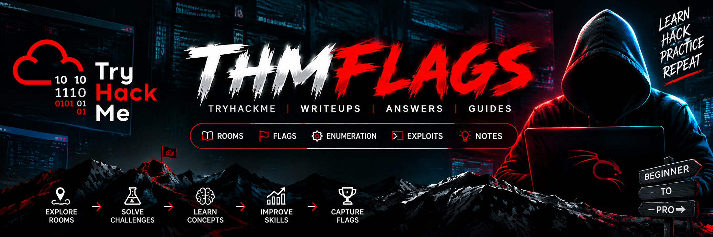

<div align="center">



# TryHackMe Database

**A structured, searchable knowledge base of TryHackMe room solutions, King of the Hill flags and badge requirements.**


</div>

---

> [!WARNING]
> **Spoiler alert.** This repository contains answers and flags. Work through each room on your own
> first. The value of TryHackMe is the hands-on learning, not the points. Use this repository as a reference
> when you are stuck, or to check your work afterwards.

## Table of Contents

1. [Overview](#overview)
2. [Repository Structure](#repository-structure)
3. [What's Inside](#whats-inside)
4. [File Format](#file-format)
5. [How to Find an Answer](#how-to-find-an-answer)
6. [Contributing](#contributing)
7. [Antivirus Notice](#antivirus-notice)
8. [Disclaimer](#disclaimer)

---

## Overview

[TryHackMe](https://tryhackme.com) is an online platform for learning cyber security through guided,
browser-based labs called **rooms**. Each room teaches a topic, such as networking, web exploitation,
privilege escalation, digital forensics or threat hunting, through a series of tasks and questions.

This repository is an offline reference library for that content. It brings together:

- **Room solutions:** the answer to every task question, kept in one plain-text file per room.
- **King of the Hill (KoTH) flags:** flags gathered from TryHackMe's competitive attack-and-defend machines.
- **Badge guide:** every known TryHackMe badge, grouped by category, with what it takes to earn it.

All content is plain text or Markdown, so it opens in any editor, searches easily with standard tools,
and is fully version-controlled.

## Repository Structure

```text
tryhackme/
├── README.md          Project overview (this file)
├── assets/            Images used by the documentation
│   └── picture.png
├── badges/            TryHackMe badge guide
│   └── README.md
├── king-of-the-hill/  King of the Hill flags, one file per machine
└── rooms/             Room solutions, grouped alphabetically
    ├── 0-9/           Rooms whose name starts with a digit
    ├── A/
    ├── B/
    │   ...
    └── Z/
```

Rooms are grouped into one folder per starting character so no single directory gets too large to browse.
Each file is named after its room title. For example, *Advent of Cyber 2024* is stored at
`rooms/A/advent of cyber 2024.txt`.

## What's Inside

### Rooms: 992 solutions

The collection spans the full TryHackMe catalogue, from beginner fundamentals to advanced challenges:

| Area | Examples of covered topics |
|:-----|:---------------------------|
| **Fundamentals** | Linux, Windows, networking, web basics, cryptography |
| **Offensive security** | Web exploitation, OWASP Top 10, Active Directory attacks, privilege escalation, red teaming |
| **Defensive security** | SOC operations, SIEM (Splunk, ELK), incident response, threat hunting, phishing analysis |
| **Forensics & malware** | Disk and memory forensics, NTFS analysis, static and dynamic malware analysis |
| **Cloud & DevSecOps** | Containers, CI/CD security, infrastructure as code, security engineering |
| **CTF challenges** | Boot-to-root machines and themed capture-the-flag rooms |
| **Events** | Advent of Cyber (2019 to 2024), side quests, TryHack3M |

<details>
<summary><b>Rooms per folder</b></summary>

| Folder | Rooms | Folder | Rooms | Folder | Rooms |
|:------:|------:|:------:|------:|:------:|------:|
| `0-9` | 3  | `I` | 76 | `S` | 90 |
| `A`   | 74 | `J` | 15 | `T` | 68 |
| `B`   | 64 | `K` | 14 | `U` | 10 |
| `C`   | 77 | `L` | 53 | `V` | 19 |
| `D`   | 40 | `M` | 47 | `W` | 55 |
| `E`   | 29 | `N` | 33 | `X` | 5  |
| `F`   | 26 | `O` | 31 | `Y` | 9  |
| `G`   | 18 | `P` | 53 | `Z` | 4  |
| `H`   | 37 | `R` | 42 | **Total** | **992** |

</details>

### King of the Hill: 10 machines

KoTH is TryHackMe's competitive game mode. Players attack the same machine, take control of it and
defend it against everyone else. The [`king-of-the-hill/`](king-of-the-hill) folder lists the flags found on each machine:

| Machine | Flags | Machine | Flags |
|:--------|:-----:|:--------|:-----:|
| Food | 8 | Offline | 8 |
| Fortune | 5 | Production | 3 |
| H1-Medium | 5 | Shrek | 7 |
| Hackers | 9 | Space Jam | 2 |
| Hogwarts | 4 | Tyler | 5 |

### Badges: 89 badges

The [badge guide](badges/README.md) groups every badge by category:

- **Activity badges:** day streaks (7 to 1,500 days), weekly leagues and achievements.
- **Room badges:** organized into Fundamentals, Offensive Security, Defensive Security,
  Security Engineering & DevSecOps, and Events & Seasonal.
- **Retired badges:** badges that can no longer be earned.

Each room badge links to the matching solution in this repository where one exists.

## File Format

Every room file follows the same predictable layout, which makes it easy to read and to search:

```text
<Room title>
<TryHackMe room URL>

<Question 1>
<Answer 1>

<Question 2>
<Answer 2>
...
```

KoTH files start with a `Flags` heading, followed by one flag per line.

## How to Find an Answer

**On GitHub**

1. Open the [`rooms/`](rooms) folder and pick the folder for the room's first letter.
2. Or press <kbd>T</kbd> anywhere in the repository and type part of the room name to jump straight to it.

**Locally**

```bash
git clone https://github.com/deepmaha2006/tryhackme-writeups.git
cd tryhackme

# Find a room by name
find rooms -iname "*advent*"

# Find a room by its TryHackMe URL code
grep -ril "tryhackme.com/room/blue" rooms/

# Find the answer to a specific question
grep -ri -A1 "what is the flag" rooms/
```

On Windows PowerShell, use `Select-String`:

```powershell
Get-ChildItem rooms -Recurse | Select-String -Pattern "question text" -Context 0,1
```

## Contributing

To add a new room or update an existing one:

1. Create or edit `rooms/<first letter>/<room title in lowercase>.txt`. Use `rooms/0-9/` for names that start with a digit.
2. Follow the [file format](#file-format): the title on line 1, the room URL on line 2, then question and answer pairs.
3. Badge changes go in [`badges/README.md`](badges/README.md), under the matching category.
4. Commit with a clear message, for example `Add room: <room title>`.

## Antivirus Notice

> [!NOTE]
> Some write-ups include exploit or reverse-shell snippets taken from the rooms, such as
> `rooms/O/overpass 2 - hacked.txt`. Antivirus software such as Microsoft Defender may flag these
> plain-text notes as malicious (for example `Exploit:PHP/RevWebshell`) and quarantine them on
> checkout. They are notes, not executable code. To keep them on disk, add an antivirus exclusion
> for your local clone.

## Disclaimer

This repository is for **educational purposes only**. The techniques referenced in these rooms must only
be used on systems you own or are explicitly authorized to test. This project is not affiliated with,
endorsed by or sponsored by TryHackMe.

<div align="center">

<sub>Happy hacking. Learn first, look up second.</sub>

</div>
